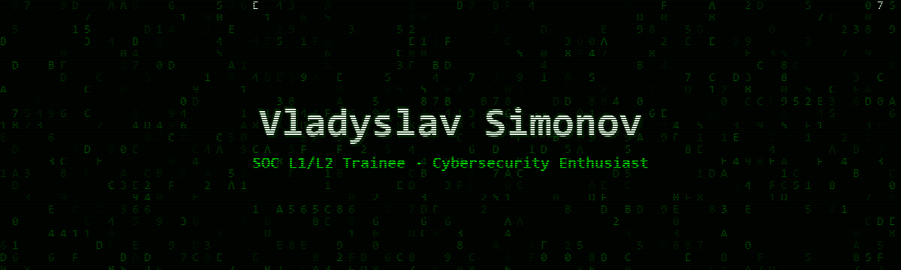

<div align="center">


<br/>

`@227x0` · 🌍 Open to international opportunities

[](https://github.com/227x0)
[](https://github.com/227x0)

</div>

---

## 👨‍💻 About Me

I'm **Vladyslav Simonov** — a **Computer Engineering** student (Specialty 123) finishing my **Professional Junior Bachelor** degree in Ukraine.

I have a hands-on engineering background in **Python backend development** and real-world projects, and I'm now transitioning into **cybersecurity**. My current focus is **SOC operations**, **Linux hardening**, and building a home lab with tools like **Wazuh**, **Kali Linux**, and **VirtualBox**.

```python
class Vladyslav:
    def __init__(self):
        self.name = "Vladyslav Simonov"
        self.degree = "Professional Junior Bachelor — Computer Engineering (123)"
        self.current_focus = ["SOC L1/L2", "Incident Response", "Linux Security", "Threat Detection"]
        self.next_chapter = "Security operations & international cybersec roles"
        self.philosophy = "Detect early. Respond fast. Learn continuously."
```

---

## 🛡️ Cybersecurity Path


| Phase | Focus |
|-------|-------|
| **Now** | Finishing Professional Junior Bachelor in Computer Engineering |
| **Learning** | SOC operations, incident triage, MITRE ATT&CK, log analysis |
| **Building** | Home lab: Wazuh SIEM, Kali attacks, Ubuntu targets, detection rules |
| **Goal** | International SOC / security engineering roles |

---

## 🧰 Tech Stack

### Development
<p align="center">
  
  
  
  
  
</p>

### Security & Infrastructure
<p align="center">
  
  
  
  
  
  
</p>

**Also exploring:** Wireshark · Nmap · Burp Suite · OWASP · Secure coding · Cryptography · SIEM correlation rules

---

## 🚀 Featured Projects

### [soc-practice](https://github.com/227x0/soc-practice)

> Hands-on SOC cases from my home lab. Each case covers attack → detection → triage → escalation → response.

- SSH brute-force detection with Wazuh
- MITRE ATT&CK mapping
- L1 triage checklist and L2 escalation templates
- IOCs and response playbooks

---

## 🗣️ Languages

| Language | Level |
|----------|-------|
| Ukrainian | C1 (native proficiency) |
| Russian | C1 |
| English | B2 |
| Czech | B2 |

---

## 📊 GitHub Activity

<p align="center">
  
  
</p>

<p align="center">
  
</p>

---

## 💡 What I Bring

| Area | Evidence |
|------|----------|
| **Engineering mindset** | Computer Engineering degree — from hardware to software |
| **Real-world projects** | Telegram bots, API integrations, access control systems |
| **Security awareness** | ACL, secret management, secure architecture, incident triage |
| **Hands-on lab work** | Wazuh SIEM, attack simulations, log analysis |
| **Self-driven learner** | Cybersecurity path beyond coursework |
| **Clear communicator** | README docs, architecture notes, structured write-ups |

---

## 📌 Currently

- 🎓 Finishing **Professional Junior Bachelor — Computer Engineering (123)**
- 🔐 Building **SOC skills** through home labs and case studies
- 🛠️ Maintaining **[soc-practice](https://github.com/227x0/soc-practice)** — detection & response cases
- 🌍 Preparing portfolio for **international cybersecurity roles**

---

<div align="center">

### Let's connect

[](https://github.com/227x0)
[](https://github.com/227x0/soc-practice)

<br/>

*"Good engineers build systems. Great engineers build systems that don't break — and know exactly why when they do."*


</div>
