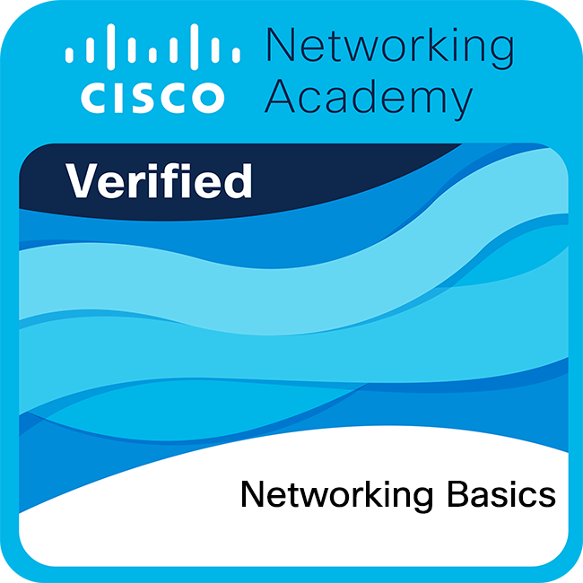
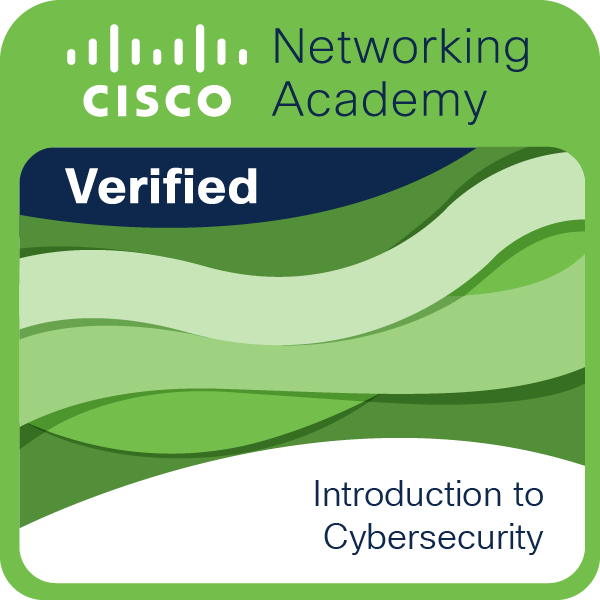

> **Focused on SOC operations, incident response, and detection engineering.**

# Vladyslav Simonov

Computer Engineering graduate (**Professional Junior Bachelor**) moving into **cybersecurity**.
I learn by running a home SOC lab that mirrors a real L1 desk: SIEM, EDR, network IDS,
ticketing — and by attacking it myself from Kali.

## What I practice (hands-on, documented)

- **Full alert lifecycle**: attack → SIEM alert/archive → L1 triage → escalation ticket → response notes
- **Triage runbooks** for SSH brute-force, DNS anomalies, web attacks
- **Threat hunting in raw archives** when alerts don't fire (case: DNS exfiltration, 39 events / 0 alerts)
- **Bash tooling** for attack simulation (DNS exfil scripts, subdomain enumeration)
- **MITRE ATT&CK mapping** for every case

## Featured projects

### [soc-practice](https://github.com/227x0/soc-practice) — SOC cases from the home lab

| Case | Topic |
|---|---|
| [01](https://github.com/227x0/soc-practice/tree/master/cases/01-ssh-bruteforce) | SSH brute-force: attack → correlation rule 40112 → L1 escalation |
| [02](https://github.com/227x0/soc-practice/tree/master/cases/02-juice-shop-web-attack) | Juice Shop kill-chain: recon → SQLi → admin JWT → PII exfiltration |
| [03](https://github.com/227x0/soc-practice/tree/master/cases/03-lab-upgrade-arsenal-telemetry) | Lab upgrade: PD attack stack, auditd telemetry, custom Wazuh rules |
| [04](https://github.com/227x0/soc-practice/tree/master/cases/04-dns-exfiltration-hunting) | DNS exfiltration hunting: 0 alerts, found in archives, full triage |

### [soc-lab](https://github.com/227x0/soc-lab) — the infrastructure

Network design, detection pipeline, L1 operations (runbooks, incident register,
shift handover), ops runbook with real failure postmortems.

## Certifications

-1ba098)

## Languages

Українська · Русский · English · Čeština (daily use)
